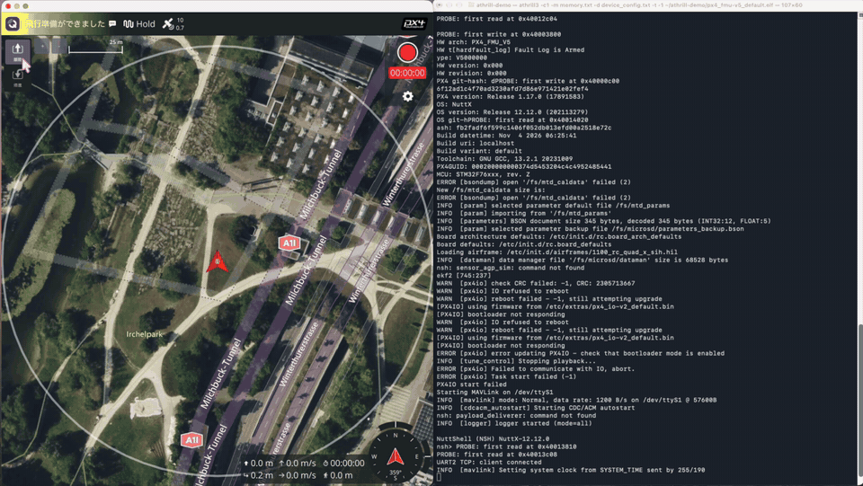
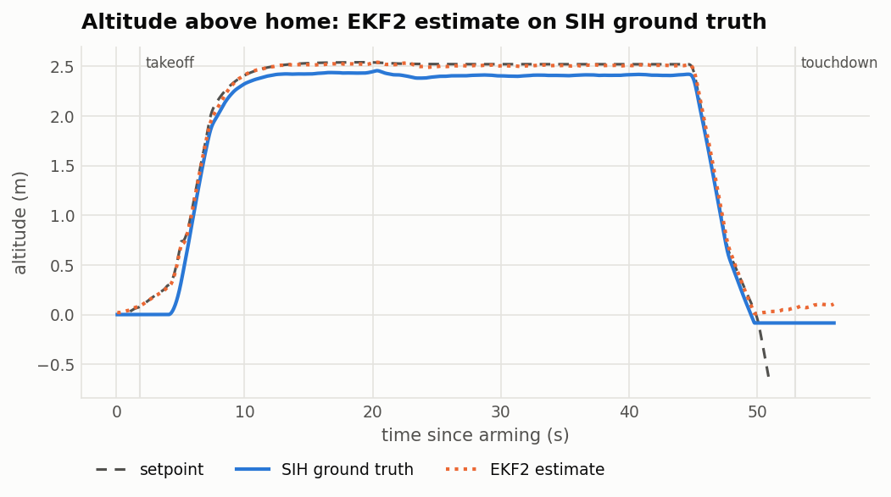

# Athrill STM32 — run PX4's Pixhawk 4 firmware without a flight controller

[](https://github.com/hakoniwalab/athrill-target-stm32/actions/workflows/ctest.yml)
[](https://github.com/hakoniwalab/athrill-target-stm32/actions/workflows/px4.yml)

**Unmodified `px4_fmu-v5_default.elf` — NuttX, interrupts, DMA and all — on your laptop, flown from QGroundControl, with bit-identical replays.**



*QGroundControl flying PX4 v1.17.0 SIH on the emulated Pixhawk 4, with PX4's console on the right (4× speed). Prebuilt binaries and the ELF: [Release v0.1.1](https://github.com/hakoniwalab/athrill-target-stm32/releases/tag/v0.1.1).*

A virtual Pixhawk 4 (FMUv5, STM32F765): no flight controller needed.

PX4's Software-in-the-Loop (SITL) is an excellent way to develop and test flight
software. But what if we also want to run the firmware built for an actual
flight-controller board, including NuttX, its interrupt handling, and STM32
peripheral drivers, **before putting it on hardware**?

This project explores **Processor-in-the-Loop (PIL)** as a complementary testing
option. It extends the open-source [Athrill](https://github.com/toppers/athrill)
microcontroller emulator with an Armv7-M (Cortex-M7) target and functional
STM32F7 / Pixhawk 4 devices. The result runs the regular PX4
`px4_fmu-v5_default.elf` build on a development computer, rather than a
host-native `px4_sitl` build.

We started with the established **Pixhawk 4 / FMUv5** platform
(STM32F765, 216 MHz), so PX4 developers can try a recognizable
board-target configuration. This is a lightweight *functional* emulator,
not a cycle-accurate or electrically accurate substitute for real hardware.

## What works today

The stock PX4 `px4_fmu-v5_default` firmware boots on the emulated Pixhawk 4,
runs PX4's **SIH** (simulation-in-hardware) quadcopter, talks MAVLink to
QGroundControl over TCP, takes off to the default **2.5 m** and hovers there
(2.45–2.54 m in the estimate), and writes its ULog to the emulated microSD card, which can
be mounted on the host afterwards. Everything used is public: Athrill, this
target, PX4 itself and QGroundControl.

In SIH, PX4 computes the vehicle and its sensor data internally
(`SYS_HITL=2`) and does not start the board's sensor drivers: **the
emulated sensor chips are not in the SIH data path**.
PX4's own sensor drivers on those chips are exercised separately, on a bench
with public parts and in flight with external physics (see [Beyond SIH](#beyond-sih-px4s-sensor-drivers-and-external-physics)).

## Why PIL in addition to SITL and HITL?

| Approach | Firmware execution | Physical flight controller |
| --- | --- | --- |
| **SITL** | Host-built PX4 with simulation interfaces | Not required |
| **HITL / SIH on hardware** | Board-target PX4 on a real flight controller | Required |
| **Athrill PIL + SIH** | Board-target PX4 and NuttX on an emulated MCU; PX4's internal SIH physics | **Not required** |

The intended use is to explore firmware bring-up, board-specific integration,
driver behavior, and reproducible regression scenarios without having a Pixhawk
connected for every test. PIL complements rather than replaces SITL or tests on
real hardware; these are potential uses, not claims of complete verification
coverage.

## Emulated hardware

The target models the parts of the **Pixhawk 4 / STM32F765** that the demonstrated
firmware paths need:

| Area | Current implementation |
| --- | --- |
| CPU | Cortex-M7 / Armv7-M Thumb-2, DSP, FPv5-D16; NVIC, SysTick, exceptions and context switching |
| Board initialization | Lightweight RCC / clock / GPIO and board support |
| Communications | STM32 UART/USART, baud-timed RX/TX, DMA and UART-to-localhost-TCP bridge for MAVLink / QGroundControl |
| Buses and timing | SPI, I2C, DMA, EXTI, timers and FMU AUX PWM outputs |
| Parameters | FM25V02A F-RAM on SPI, optionally persisted to a host file |
| Flight logging | microSD on SDMMC1, including DMA transfer and a host-backed FAT32 image with PX4 ULog files |
| Sensor chips | ICM-20689 IMU (SPI1 / DMA / 8 kHz data-ready), MS5611 barometer (SPI4), IST8310 magnetometer (I2C3), u-blox M8 GPS (USART1) |

These are *functional register-level models*: they implement the interactions
the tested firmware uses, not every feature of the silicon. The emulated
Pixhawk 4's separate PX4IO co-processor and USB are not currently modeled.
For the external-physics demonstration, motor outputs are assigned to FMU
AUX1–AUX4 rather than PX4IO's MAIN outputs.

## Getting started

### 1. Build Athrill STM32

Place three repositories side by side, at the versions these results come
from (Athrill 3.0.0; athrill-arm-common moves on):

```sh
git clone --branch v3.0.0 --depth 1 https://github.com/toppers/athrill.git
git clone https://github.com/hakoniwalab/athrill-arm-common.git
git -C athrill-arm-common checkout 60d8098
git clone https://github.com/hakoniwalab/athrill-target-stm32.git
cd athrill-target-stm32

cmake -S . -B build -DCMAKE_BUILD_TYPE=Release
cmake --build build --parallel
(cd build && ctest --output-on-failure)
```

As a small smoke test, run the included bare-metal example:

```sh
./build/athrill3 -c1 -m test/hello/memory.txt -d test/hello/device_config.txt -t 100000 test/hello/hello.elf
```

Expected console output includes `Hello, Athrill STM32!`; the run then
stops at its clock limit (`EXIT for timeout(100000).`, exit status 1).

### 2. Build the PX4 firmware

The stock Pixhawk 4 target of PX4 v1.17.0, the current stable release,
unmodified, with PX4's build image (Docker), beside the other repositories
(about 6 minutes; `make` fetches the submodules it needs):

```sh
cd ..
git clone --branch v1.17.0 --depth 1 https://github.com/PX4/PX4-Autopilot.git PX4
docker run --rm -v "$PWD/PX4:/src" -w /src px4io/px4-dev:v1.17.0-beta1 make px4_fmu-v5_default
ls -l PX4/build/px4_fmu-v5_default/px4_fmu-v5_default.elf
```

PX4 `main` works too (checked at `216039a`; see
[docs/verification.md](docs/verification.md)). Athrill loads the **ELF**
(it needs the symbols), not the `.px4` upload file, and starts PX4 itself
at `0x08008000`, past the bootloader, which is not run. `px4_sitl` is not a substitute: the point is
the board-target build. On Linux the container's files under `PX4/build`
belong to root (`sudo chown -R "$USER" PX4` if you want them back).

### 3. Run PX4 SIH

[examples/px4-sih](examples/px4-sih) has the memory map, the device
configuration and a script. Its first run makes the microSD card image
(1 GB FAT32) and selects the SIH airframe (`SYS_AUTOSTART 1100`, kept in the
emulated F-RAM, `fram.bin`); every run then boots PX4 with its console on
the terminal. The SD card image is written by python3, the same byte for
byte on every host.

```sh
cd athrill-target-stm32
examples/px4-sih/run.sh ../PX4/build/px4_fmu-v5_default/px4_fmu-v5_default.elf
```

PX4's TELEM1 is on TCP `127.0.0.1:5760`: add a TCP link to it in
**QGroundControl** (Application Settings, Comm Links), or use pymavlink with
`tcp:127.0.0.1:5760`, then arm and take off as usual. The vehicle starts at
PX4's SIH home (Zurich). Stop with Ctrl+C. The ULog files are in the SD
card image (`examples/px4-sih/sd.img`, `log/`), which macOS mounts with
`hdiutil attach -imagekey diskimage-class=CRawDiskImage sd.img`; on Linux
mtools reads it without mounting (`mdir -/ -i sd.img ::/log`,
`mcopy -i sd.img ::/log/sess000/log100.ulg .`). [docs/sih.md](docs/sih.md) explains each setting.

QGroundControl warns that HITL is enabled (`SYS_HITL=2` is how SIH runs)
and asks for radio and flight-mode setup (no RC): both are expected.

These steps were run as written on an **Apple Silicon Mac** (macOS) and on
**Windows 11 / WSL2 Ubuntu** (Intel Core Ultra 7 155H, Docker inside WSL2).
On WSL2: `sudo apt install mtools` (to read the SD card image), and the Python packages in a
venv. QGroundControl on Windows connects to PX4 in WSL2 with a TCP link to
`127.0.0.1:5760` (WSL's localhost forwarding), shows the vehicle at Zurich
and flies it. Hovering runs at RTF 2.22 on the Mac (M2 Pro) with PX4
v1.17.0; the machines and more numbers, of both hosts and PX4 versions, are
in
[docs/verification.md](docs/verification.md#test-machines).

## Performance and validation

Results from **2026-11-04**, on an Apple Silicon Mac (M2 Pro), with
virtual STM32 clock at 216 MHz (both hosts and PX4 versions in
[docs/verification.md](docs/verification.md#speed)):

| Workload | Real-time factor (RTF) |
| --- | ---: |
| PX4 v1.17.0 SIH hover, QGroundControl/MAVLink and SD logging | **2.22** |
| The same with PX4 `main` (`216039a`) | 1.92–1.94 |

An RTF above 1 means virtual simulation time advances faster than elapsed
wall-clock time for the measured workload. These are *workload- and
host-specific measurements*, not a CPU clock-accuracy result or a comparative
benchmark against other emulators. See [performance notes](docs/performance.md).

Athrill's instruction decoders are generated from Arm machine-readable
architecture data. The Arm instruction execution path uses shared
[athrill-arm-common](https://github.com/hakoniwalab/athrill-arm-common)
pseudo-code. By default the most frequent instructions use fast executors,
and floating-point arithmetic uses the host FPU wherever IEEE 754 gives the
pseudo-code's exact bits (other cases fall back to the pseudo-code); both are
checked against the reference path bit for bit on millions of random cases,
and `DEVICE_CONFIG_ARM_EXEC_MODE strict` / `DEVICE_CONFIG_ARM_FP_MODE strict`
run the pseudo-code only. Instruction, FP, and exception tests are compared with QEMU on suitable
Arm targets. See [testing](docs/testing.md) and [decoder details](docs/decoder.md).

A virtual-clock-based event model and Hakoniwa lockstep integration are
central design choices. A flight driven only by virtual time repeats exactly
(see [Verification](#verification)); input timed by the wall clock, such as
QGroundControl's commands over TCP, arrives at run-dependent virtual times,
so **complete deterministic replay across all external inputs and all
configurations has not been established**. The emulation is neither
instruction-cycle accurate nor suitable as a substitute for board-level
electrical, safety, or flight validation.

## Verification

[examples/px4-sih/verify](examples/px4-sih/verify) checks a PX4 SIH flight
end to end with one command (about 2 minutes). From one starting state
(F-RAM and SD card images after the first boot), it

- flies take off, hover, land three times from the NSH console at fixed
  virtual times, twice in the default mode and once in strict mode, and
  requires the F-RAM, the whole SD card image and the console output (but
  the strict run's two mode lines) to be identical;
- checks that flight's ULog: EKF2 against SIH's ground truth, attitude
  tracking, altitude and position hold, the arm-to-disarm sequence;
- flies arm, take off, "go to" 5 m north, land over MAVLink as
  QGroundControl does, and checks its log the same way.
- with the PX4 ELF of the Release, checks that the SD card image, ULog,
  F-RAM and console are identical, bit for bit, to the run we published
  (on the Mac; a run on WSL2 passes this check too).

What it runs, every threshold and what it does not show are in
[docs/verification.md](docs/verification.md#what-verifysh-does).

```sh
examples/px4-sih/verify/verify.sh ../PX4/build/px4_fmu-v5_default/px4_fmu-v5_default.elf
```

It needs python3 with numpy, pyulog and pymavlink (matplotlib for the
charts: `pip install numpy pyulog pymavlink matplotlib`), and on Linux mtools
to read the SD card image; without pymavlink it skips the MAVLink flight and
reports `PARTIAL PASS`. Results on
2026-11-04, all PASS on the Mac and on WSL2; charts, hashes and both hosts'
numbers are in [docs/verification.md](docs/verification.md):

<picture>
  <source media="(prefers-color-scheme: dark)" srcset="docs/verification/altitude-dark.png">
  
</picture>


PX4 v1.17.0 on the Mac (PX4 `main` and WSL2 in the verification page):

| Check | Result |
| --- | --- |
| **Determinism**: take off, hover, land, typed into the NSH console at fixed virtual times, three runs from the same F-RAM and SD card images | Two runs in the default mode and one in strict mode (Arm pseudo-code only, no fast executors, no host FPU): identical F-RAM, **whole SD card image including the ULog**, and console output apart from the strict run's two mode lines; 2,903,884,344 instructions each |
| **EKF2** (estimate vs SIH ground truth, from the ULog) | no filter faults; innovation test ratios at most 0.24 (gate 1); position error RMS 39 cm horizontal, 11 cm vertical (v1.17.0's simulated GPS adds 0.2 m white noise per fix); tilt 0.44°, heading 1.3° |
| **Attitude and position control** | hover at 2.498 m mean (2.451–2.513 m) for a 2.5 m takeoff; horizontal drift at most 28 cm |
| **QGroundControl-style MAVLink**: arm, take off, "go to" 5 m north, hover, land | all commands acknowledged; up to 20° tilt with tilt tracking RMS 1.1°; holds the target within 40 cm; lands and disarms; ULog checks as above pass |

The checks and their limits are in
[analyze_ulog.py](examples/px4-sih/verify/analyze_ulog.py) (thresholds chosen
for this SIH vehicle, not PX4 requirements). Runs that receive input over
TCP are checked by their logs, not for identity.

## Beyond SIH: PX4's sensor drivers and external physics

**On a bench, with public parts only.** With
`DEVICE_CONFIG_STM32_SENSOR_BENCH 1` and no external device, the emulated
chips report a vehicle at rest at Tokyo Station (gravity, Earth's
field, sea-level pressure, a GPS fix, with fixed-seed noise). PX4 boots as a
generic quadcopter with its own drivers for the ICM-20689 (SPI1 with DMA,
FIFO at 800 Hz), MS5611 (SPI4), IST8310 (I2C3) and u-blox (USART1); EKF2
gets a position and the preflight check passes (with the power-supply
check bypassed, `CBRK_SUPPLY_CHK`, as there is no power module to measure).
It does not fly: nothing moves the vehicle. In SIH (`SYS_HITL=2`) PX4 does
not start these drivers at all; it uses its simulated sensors.

```bash
examples/px4-bench/check.sh ../PX4/build/px4_fmu-v5_default/px4_fmu-v5_default.elf
```

`check.sh` runs 30 s twice from the same images and checks, in PX4's own
reports, that the drivers transfer without errors, the sensor validators
are OK, the GPS has a 3D fix, EKF2's position is valid and the preflight
check is OK, then that both runs reach their clock limit and give
identical console output, F-RAM and SD card image (about 1 min). `examples/px4-bench/run.sh`
boots the same setup for QGroundControl on TCP 127.0.0.1:5760.

**Flying, with external physics.** A further experiment flies with them. PX4's own
drivers read the emulated ICM-20689, MS5611, IST8310 and u-blox chips, whose
samples come from **Hakoniwa Drone** (the x500 in MuJoCo), and PX4's
PWM pulses on the FMU AUX outputs go back to it as motor commands, in
lockstep. The x500 takes off and hovers at about 2.5 m; the whole system
runs at RTF 1.48. Everything is public: Hakoniwa Drone v5.0.0 or later (free
edition) and the sensor device of [athrill-device](https://github.com/hakoniwalab/athrill-device);
[docs/hakoniwa.md](docs/hakoniwa.md) has the setup. The SIH demonstration does not need it.

## ArduPilot, and a race with Renode

The unmodified ArduCopter Pixhawk 4 firmware boots on the same emulated
board. ArduPilot also runs this firmware on Renode, so we compared the two
on one Apple M2 Pro with the same ELF:

| | Real-time factor (mean of 3) |
| --- | ---: |
| **Athrill STM32**, a branch to itself waits as `WFI` (no knowledge of the firmware) | **1.583** |
| Athrill STM32, the idle loop executed as written | 0.62 |
| Renode, ArduPilot's performance branch | 0.30 |

The emulated peripherals differ, so these are results for these two
benchmark configurations, not a fully normalised comparison of workloads.

**The same instruction addresses.** The PC traces of the two emulators agree
on 411,627 of the 411,873 instructions that Renode traced from reset. They
differ only where the firmware waits on hardware timing.

**Why Athrill is faster.** Athrill has an exact virtual clock: one
instruction is one clock.
- **No idle time is executed.** ArduCopter's idle loop is `b .`, with no
  `WFI` anywhere. Only an interrupt can leave it, so Athrill halts there and
  the clock jumps to the next event.
- **Device accesses are cheap.** A device computes its state from that clock
  when the firmware reads it, without a time framework in between.

**Documents:**
- [docs/ardupilot.md](docs/ardupilot.md): conditions, caveats and how to
  reproduce.
- [docs/time-skip.md](docs/time-skip.md): the time design, with measurements.

This is a first step. Next we connect ArduPilot to Hakoniwa, as for PX4
above, and then release v0.2.0 with a new `athrill3`.

## Related work and motivation

This is not a claim that MCU emulation is new, or that other emulators cannot
run deterministically. For example, [QEMU supports instruction counting
and record/replay](https://www.qemu.org/docs/master/system/replay.html), and
[ArduPilot documents firmware emulation with
Renode](https://ardupilot.org/dev/docs/renode-emulation.html).

[docs/athrill.md](docs/athrill.md) explains what Athrill is and how it
differs from QEMU and Renode. In one sentence, against Renode, which already
models the STM32F7 for ArduPilot: Athrill advances in virtual-time lockstep
with external physics (Hakoniwa), generates its decoders from Arm's
machine-readable data, and has a pseudo-code-only strict mode that a whole
PX4 flight matches bit for bit. Our focus is narrower: a **lightweight,
inspectable PX4 FMUv5 firmware execution path** that can be connected to the Hakoniwa simulation environment,
with explicit virtual time and testable functional peripheral models. Against
Renode we have one measured comparison, on ArduPilot
([above](#ardupilot-and-a-race-with-renode)); against QEMU, none.

An earlier [Athrill RISC-V target](https://github.com/hakoniwalab/athrill-target-riscv)
runs PX4 on the AIFoundry Erbium board, including an optional MAVLink
configuration for QGroundControl. Erbium is a board target in upstream PX4
([`boards/aifoundry/erbium`](https://github.com/PX4/PX4-Autopilot/tree/main/boards/aifoundry/erbium),
`aifoundry_erbium_default`). Athrill
([toppers/athrill](https://github.com/toppers/athrill), version 3)
supports V850, RH850, RISC-V and Armv7-M (this target); PX4 runs on two of
them, RISC-V (RV64) and Armv7-M ([docs/athrill.md](docs/athrill.md)). Starting with
the familiar **Pixhawk 4 / FMUv5** makes this work easier to evaluate for
developers using STM32-based PX4 boards.

Feedback from PX4 developers on useful test cases, missing hardware models,
reproduction steps, and limitations is very welcome.

## Design and license

- [Athrill, and how it differs from QEMU and Renode](docs/athrill.md)
- [Design decisions and staged goals](docs/design.md)
- [Survey of existing approaches](docs/survey.md)
- [Test strategy](docs/testing.md)
- [Performance measurements](docs/performance.md)
- [ArduPilot, and a comparison with Renode](docs/ardupilot.md)
- [Virtual time and the clock skip](docs/time-skip.md)

`src/cpu/decoder/t32_decode16.{h,c}` and `t32_decode32.{h,c}` are generated
from Arm's Architecture Machine Readable Specification and are provided under
Arm's BSD 3-clause licence, reproduced in those files (Copyright 2010–2026
Arm Limited or its affiliates). The rest of this repository is under the
[MIT licence](LICENSE).
