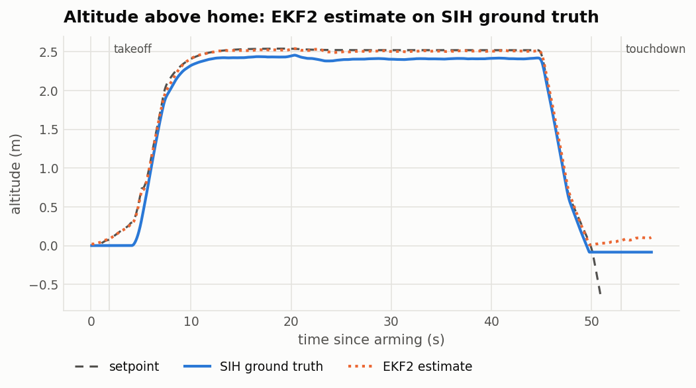
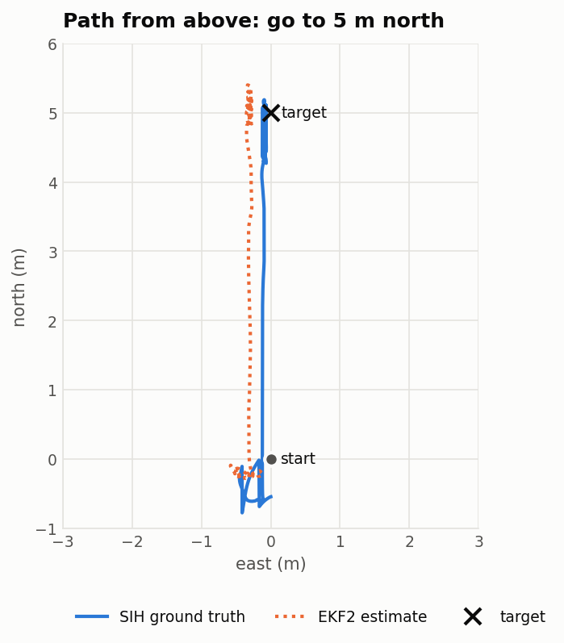
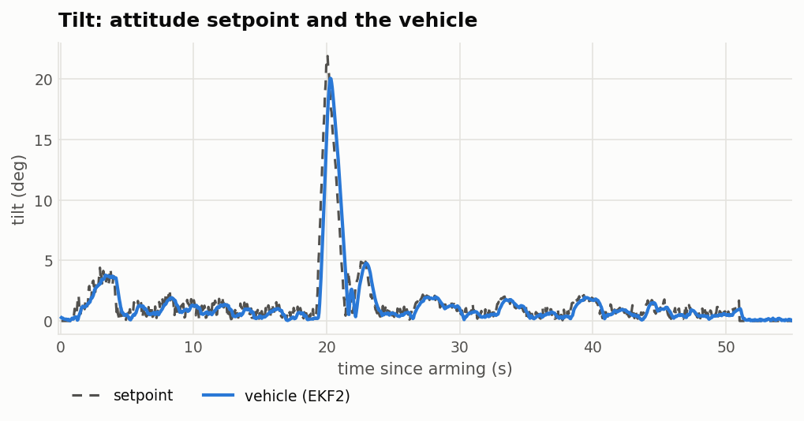
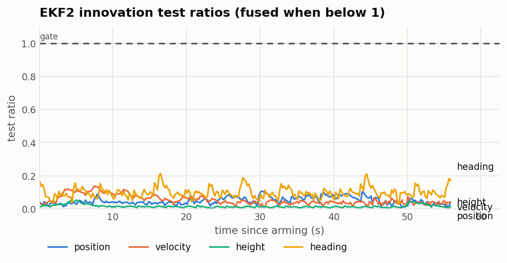

# Verification of PX4 SIH on the emulated Pixhawk 4

The evidence behind the README's claims, made by
[examples/px4-sih/verify/verify.sh](../examples/px4-sih/verify/verify.sh)
(one command, about 2 minutes) from the stock `px4_fmu-v5_default` ELF of
PX4 `216039a`. The charts come from the flight log (ULog) of its MAVLink
scenario, read from the emulated microSD card, with
[plot_ulog.py](../examples/px4-sih/verify/plot_ulog.py); the checks and their
thresholds are in [analyze_ulog.py](../examples/px4-sih/verify/analyze_ulog.py)
(chosen for this SIH vehicle, not PX4 requirements).

## What verify.sh does

```sh
examples/px4-sih/verify/verify.sh ../PX4/build/px4_fmu-v5_default/px4_fmu-v5_default.elf [athrill3]
```

It prints the ELF's SHA-256 (the results belong to that firmware), then:

1. **Golden images.** A first boot on a new F-RAM and a new 1 GB FAT32 SD
   card image selects the SIH airframe (`SYS_AUTOSTART 1100`). These two
   files are the starting state of every flight below: PX4 keeps
   parameters, logs and mission data in them, so a run that starts from a
   used image is a different experiment.
2. **A. Determinism.** The flight of [scenario.nsh](../examples/px4-sih/verify/scenario.nsh)
   (wait 12 s, `commander takeoff`, 20 s, `commander land`, 20 s) is typed
   into the NSH console, which Athrill delivers at fixed virtual times, so
   nothing depends on the host's clock. It runs three times at once from
   copies of the golden images, for 16 G clocks (74 s of virtual time):
   twice in the default mode, once in strict mode. The console output, the
   F-RAM and the whole SD card image must be byte for byte the same.
   Agreement with strict mode also shows that the fast paths (fast
   executors, host FPU) compute exactly what the Arm pseudo-code does.
3. **B. Checks of A's flight log.** The ULog is read from the SD card
   image (mtools, or hdiutil on macOS) and checked by
   [analyze_ulog.py](../examples/px4-sih/verify/analyze_ulog.py) (table
   below).
4. **C. A QGroundControl-style flight**, when pymavlink is installed: PX4
   runs with MAVLink on TCP, and
   [fly_scenario.py](../examples/px4-sih/verify/fly_scenario.py) arms,
   takes off, sends "go to" 5 m north (`MAV_CMD_DO_REPOSITION`), hovers
   15 s, lands and waits for the disarm, timing each phase by the
   vehicle's clock. Its log gets the same checks, plus holding the target.
   With matplotlib, [plot_ulog.py](../examples/px4-sih/verify/plot_ulog.py)
   draws the charts of this page from it.

The script ends with `ALL PASS` and exit status 0, or `SOME CHECKS FAILED`
and 1. Its files stay in `examples/px4-sih/verify/work/`: `golden/`,
`fast1/`, `fast2/`, `strict/` and `mavlink/` (each with its console output,
F-RAM and SD card image), `a.ulg`, `mavlink/c.ulg` and `charts/`.

### The checks of a flight log

The thresholds are for this SIH quadcopter, chosen to catch a broken
flight, not PX4 requirements. "Flying" is from takeoff to touchdown as
`vehicle_land_detected` reports them.

| Check | Topics | Passes when |
| --- | --- | --- |
| log | the ULog | no dropouts |
| flight | `vehicle_status`, `vehicle_land_detected` | armed, airborne, landed again, disarmed at the end |
| ekf2 faults | `estimator_status` | `filter_fault_flags` always 0 |
| ekf2 innovations | `estimator_status` | position, velocity, height and heading test ratios below 1 (inside PX4's gates) while armed |
| ekf2 position vs truth | `vehicle_local_position`, `…_groundtruth` | while flying, horizontal and vertical error below 0.5 m |
| ekf2 tilt vs truth | `vehicle_attitude`, `…_groundtruth` | tilt error RMS below 0.5°, max below 2° (the two topics are sampled at different times, so fast attitude changes show a lag) |
| ekf2 heading vs truth | the same | heading error below 5° |
| attitude tracking | `vehicle_attitude`, `vehicle_attitude_setpoint` | tilt error RMS below 2° while flying |
| altitude hold | `vehicle_local_position` | from reaching 2.5 m (within 5 cm) to the descent: mean within 5 cm of 2.5 m, every sample within 15 cm |
| position hold | `vehicle_local_position` | A: horizontal drift while hovering below 0.3 m; C: within 0.3 m of the target over the last 5 s |

### What it does not show

- **PX4's sensor drivers.** SIH gives PX4 its sensor data directly; the
  emulated chips are not in this data path (README, "Beyond SIH").
- **Timing of the real board.** Every instruction takes one clock of the
  virtual 216 MHz; PX4's CPU load and its real-time margins on a Pixhawk
  are not modelled.
- **Identity across hosts.** Each host's runs are identical, but different
  ELFs give different instruction counts; one ELF on two hosts is not
  compared here.
- **Identity of MAVLink runs.** C's commands arrive at wall-clock times,
  so its runs differ in detail; they are judged by their logs only.

## The flight

Arm, take off to the default 2.5 m, "go to" a point 5 m north (`MAV_CMD_DO_REPOSITION`,
what QGroundControl sends for "Go to location"), hover, land, disarm: all over
MAVLink on TCP, as QGroundControl does ([fly_scenario.py](../examples/px4-sih/verify/fly_scenario.py)).
SIH logs its own ground truth next to the EKF2 estimate.

<picture>
  <source media="(prefers-color-scheme: dark)" srcset="verification/altitude-dark.png">
  
</picture>

<picture>
  <source media="(prefers-color-scheme: dark)" srcset="verification/path-dark.png">
  
</picture>

<picture>
  <source media="(prefers-color-scheme: dark)" srcset="verification/tilt-dark.png">
  
</picture>

<picture>
  <source media="(prefers-color-scheme: dark)" srcset="verification/ekf2-ratios-dark.png">
  
</picture>

| Check (MAVLink scenario) | Apple Silicon Mac | WSL2, Intel Core Ultra 7 155H |
| --- | --- | --- |
| Commands acknowledged (arm, takeoff, reposition, land) | all | all |
| EKF2 filter faults | none | none |
| EKF2 innovation test ratios, max (position, velocity, height, heading) | 0.02, 0.05, 0.18, 0.15 | below 1 (PASS) |
| EKF2 position vs ground truth, RMS (horizontal, vertical) | 5.1 cm, 2.2 cm | 5.0 cm |
| Tilt tracking error, RMS (max tilt) | 1.19° (21.2°) | 1.20° (21.2°) |
| Hover altitude, mean (target 2.5 m) | 2.490 m | 2.489 m |
| Distance to the target over the last 5 s, mean / max | 13 cm / 18 cm | 13 cm / 18 cm |

After touchdown, SIH's ground truth ends 0.2 to 0.5 m below the takeoff
point and the estimate settles back to 0: SIH's simple ground model
(`sih.cpp`, "fake ground") stops the vehicle only once it is below the
reference altitude. This is PX4's SIH, computed the same in strict mode
(below), not the emulator.

## Determinism

The same flight typed into the NSH console at fixed virtual times
([scenario.nsh](../examples/px4-sih/verify/scenario.nsh): take off, hover,
land), three times from the same F-RAM and SD card images, in parallel:
twice in the default mode, once in strict mode (`DEVICE_CONFIG_ARM_FP_MODE`
and `DEVICE_CONFIG_ARM_EXEC_MODE strict`: Arm pseudo-code only, no fast
executors, no host FPU).

| Run (Mac) | Instructions | SD card image after the run, SHA-256 | F-RAM, SHA-256 | Console, SHA-256 |
| --- | ---: | --- | --- | --- |
| fast 1 | 3,507,861,181 | `95ce250e9d41b178…` | `8972ebd62a8ca8e2…` | `82900639c8396631…` |
| fast 2 | 3,507,861,181 | `95ce250e9d41b178…` | `8972ebd62a8ca8e2…` | `82900639c8396631…` |
| strict | 3,507,861,181 | `95ce250e9d41b178…` | `8972ebd62a8ca8e2…` | `82900639c8396631…` |

The whole 1 GB SD card image, with the ULog, is the same bit for bit, and
the fast paths give exactly the pseudo-code's results over the whole
flight. On WSL2 the three runs are identical too. The counts belong to the
ELF each host built (`verify.sh` prints its SHA-256 first):

| Host | `px4_fmu-v5_default.elf`, SHA-256 | Instructions of each run |
| --- | --- | ---: |
| Apple Silicon Mac (arm64 build image) | `3b1e760d380493539212d1d414612aabbe7ef2e65197bfe83215caad8c11c482` | 3,507,861,181 |
| WSL2, Intel Core Ultra 7 155H (amd64 build image) | `2a8a47df1f67c58a3d97de05716c2952a409f080eede6f67d16b1ce0a37c7e72` | 3,507,214,657 |

The two ELFs differ (PX4 embeds build information, and the images differ),
so their counts are not compared with each other.

Input timed by the wall clock, such as QGroundControl's commands over TCP,
arrives at run-dependent virtual times: those runs are checked by their
logs, not for identity.

## QGroundControl

On the Mac and on Windows (QGroundControl on Windows, PX4 on Athrill in
WSL2, TCP link to `127.0.0.1:5760` through WSL's localhost forwarding), the
vehicle shows at PX4's SIH home in Zurich and is armed, taken off, moved
and landed from QGroundControl by hand.

## Test machines

| | Mac | WSL2 PC |
| --- | --- | --- |
| Machine | MacBook Pro (Mac14,9) | MouseComputer S4I7G60SRDDC (notebook), on AC, Windows power plan "High performance" |
| CPU | Apple M2 Pro, 12 cores (8 performance, 4 efficiency) | Intel Core Ultra 7 155H, 16 cores / 22 threads |
| Memory | 32 GB | 63.4 GB (WSL2 sees 31 GB, the default half) |
| OS | macOS 27.2 | Windows 10.0.26300.9711, WSL 2.4.13.0 (kernel 5.15.167.4), Ubuntu 24.04.4 LTS |
| Compiler, CMake | Apple clang 21.0.0, CMake 4.4.3 | gcc 13.3.0, CMake 3.28.3 |
| PX4 build | Docker, `px4io/px4-dev:v1.17.0-beta1` (arm64) | Docker 29.8.2 inside WSL2, same image (amd64) |

## Speed

RTF is virtual time over wall-clock time (above 1: faster than real time);
Athrill runs on one host core. All runs in the default fast mode unless
marked strict.

| Workload | Mac (M2 Pro) | WSL2 PC (Core Ultra 7 155H) |
| --- | ---: | ---: |
| SIH hover over MAVLink, SD logging (`run.sh` + pymavlink) | 1.92 | 1.29 (1.34 just after the GPS fix) |
| NSH flight of verify.sh A, boot to disarm, 74 s of virtual time, one run alone | 2.01 | not measured alone |
| The same, strict mode (Arm pseudo-code only) | 1.58 | not measured alone |
| `verify.sh`, everything (A runs its 3 flights in parallel) | about 100 s | 159 s |
| Build: Athrill (cmake, build, ctest) | not timed | 44 s |
| Build: PX4 (clone and submodules / Docker make with the image pull) | not timed | 266 s / 394 s |

Hakoniwa Drone PRO's x500 (README, "Beyond SIH") runs at RTF 1.48 on the
Mac, the whole system with MuJoCo and no viewer.
