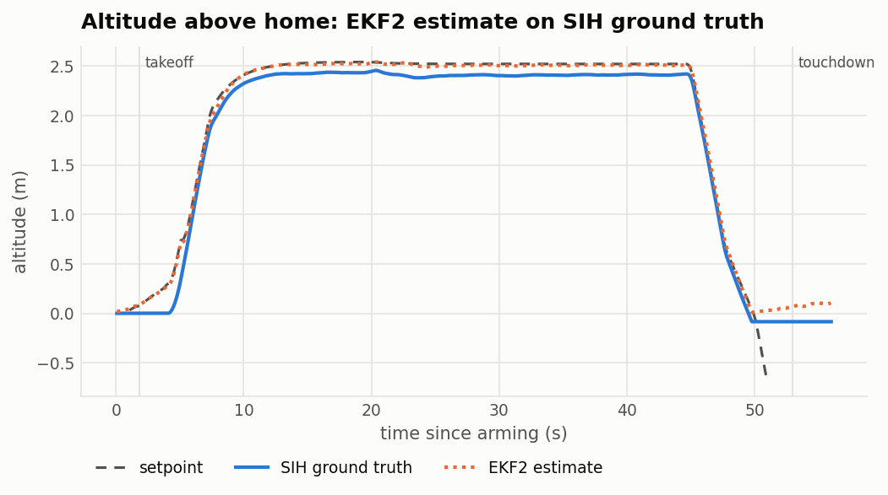
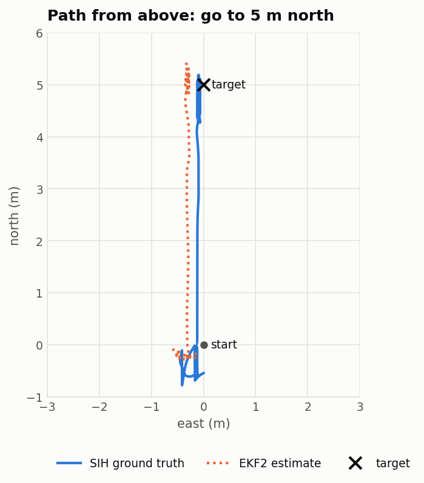
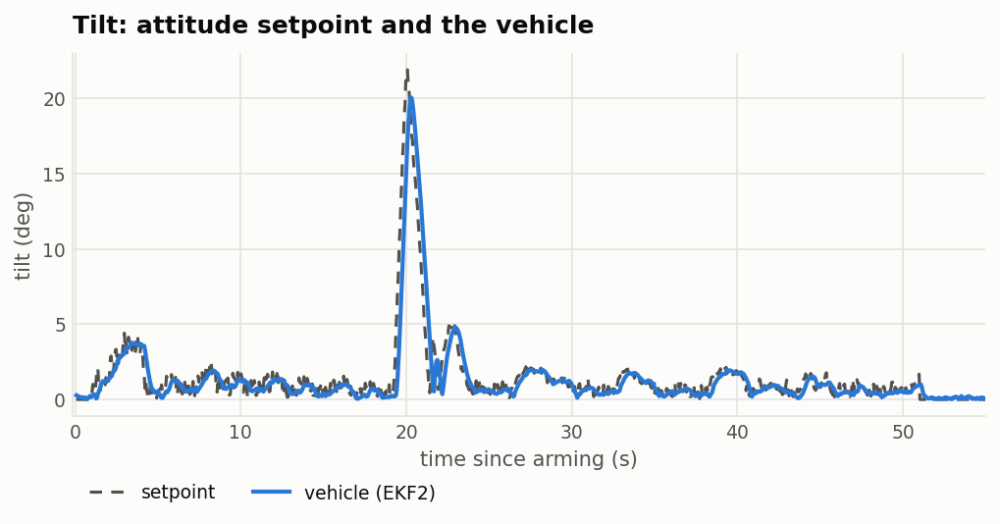
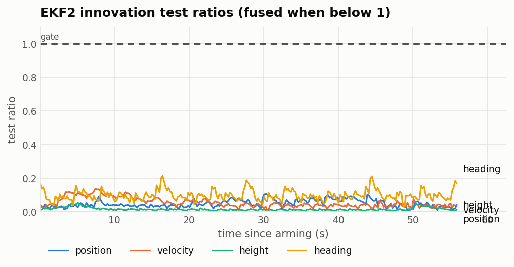

# Verification of PX4 SIH on the emulated Pixhawk 4

The evidence behind the README's claims, made by
[examples/px4-sih/verify/verify.sh](../examples/px4-sih/verify/verify.sh)
(one command, about 2 minutes) from the stock `px4_fmu-v5_default` ELF of
PX4 v1.17.0, the current stable release (and of PX4 `main` at `216039a`,
where marked). The charts come from the flight log (ULog) of its MAVLink
scenario, read from the emulated microSD card, with
[plot_ulog.py](../examples/px4-sih/verify/plot_ulog.py); the checks and their
thresholds are in [analyze_ulog.py](../examples/px4-sih/verify/analyze_ulog.py)
(chosen for this SIH vehicle, not PX4 requirements).

## What verify.sh does

Start with [PX4 on Pixhawk 4](../README.md#px4-on-pixhawk-4) in the README.
Run the commands here from the same directory and shell. For the full
verification, install Python 3 and, on Ubuntu or WSL2, install venv support
and mtools:

```sh
sudo apt-get update
sudo apt-get install -y python3-venv mtools
```

On macOS, `verify.sh` can read the SD image with `hdiutil`. On both Linux
and macOS, create and activate a Python virtual environment:

```sh
python3 -m venv .venv
. .venv/bin/activate
python -m pip install numpy pyulog pymavlink matplotlib
```

```sh
athrill-target-stm32/examples/px4-sih/verify/verify.sh px4_fmu-v5_default.elf "$ATHRILL3"
```

It prints the ELF's SHA-256 (the results belong to that firmware), then:

1. **Golden images.** A first boot on a new F-RAM and a new 1 GB FAT32 SD
   card image selects the SIH airframe (`SYS_AUTOSTART 1100`). These two
   files are the starting state of every flight below: PX4 keeps
   parameters, logs and mission data in them, so a run that starts from a
   used image is a different experiment.
2. **A. Determinism.** Three [headless flights](#repeating-a-run-and-comparing-it)
   use the same NSH inputs and copies of the golden images. The script
   compares the F-RAM, whole SD card image, normalized console and
   instruction count.
3. **B. Checks of A's flight log.** The ULog is read from the SD card
   image (mtools, or hdiutil on macOS) and checked by
   [analyze_ulog.py](../examples/px4-sih/verify/analyze_ulog.py) (table
   below).
4. **C. A QGroundControl-style flight**, when pymavlink is installed: PX4
   runs with MAVLink on TCP, and
   [fly_scenario.py](../examples/px4-sih/verify/fly_scenario.py) arms,
   takes off, sends "go to" 5 m north (`MAV_CMD_DO_REPOSITION`), hovers
   15 s, lands and waits for the disarm, timing each phase by the
   vehicle's clock. Its log gets the same checks, plus holding the target.
   With matplotlib, [plot_ulog.py](../examples/px4-sih/verify/plot_ulog.py)
   draws the charts of this page from it.
5. **D. The published run.** With the release ELF, the script checks A's
   outputs and instruction count against the values below.

The script ends with `ALL PASS` (exit status 0), `SOME CHECKS FAILED` (1),
or `PARTIAL PASS` (2) when pymavlink is missing and C was skipped. The full
run puts A's extracted ULog in `work/a.ulg`, C's ULog in
`work/mavlink/c.ulg`, and C's charts in `work/charts/`.

<a name="determinism"></a>

## Repeating a run and comparing it

From the [PX4 Quick start](../README.md#px4-on-pixhawk-4) directory, run
the first boot and step A with Python 3. Allow about a minute or two,
depending on the host.

```sh
athrill-target-stm32/examples/px4-sih/verify/verify.sh --step-a px4_fmu-v5_default.elf "$ATHRILL3"
```

Athrill types [scenario.nsh](../examples/px4-sih/verify/scenario.nsh) into
the NSH console at fixed virtual times. The script waits 12 s, commands
takeoff, waits 20 s, commands landing, and waits another 20 s. The three
runs use copies of the same F-RAM and SD images and run in parallel for
16 billion virtual clocks (74 s). Two use the default fast mode and one
uses strict mode (Arm pseudo-code only; the host FPU, the JIT and tick
skip off). To enable the JIT and tick skip in the fast runs, append the two
[device configuration lines](../README.md#build-from-source) directly to
`athrill-target-stm32/examples/px4-sih/device_config.txt`.

The script prints the comparison as it goes. An excerpt of a run on macOS
arm64 with the v0.5.0 `athrill3`, the JIT and tick skip on:

```text
A. determinism: 2 runs fast, 1 run strict, in parallel
  [PASS] fast1 = fast2: F-RAM, SD card image and normalized console identical (2904813819 instructions)
  [PASS] fast1 = strict: F-RAM, SD card image and normalized console identical (2904813819 instructions)
...
D. the same as the published run (release ELF)
  [PASS] SD card image, ULog, F-RAM, normalized console and instruction count match the published run (SD card image sha256 fdf844face8f088a...)
ALL PASS
```

Each invocation recreates `athrill-target-stm32/examples/px4-sih/verify/work/`.
`golden/` holds the first boot and starting images. Each run (`fast1/`,
`fast2/`, `strict/`) leaves:

| File | Contents |
| --- | --- |
| `console.txt` | PX4's console (UART7) as printed |
| `console.normalized.txt` | the same without Athrill's own start-up lines; the compared file |
| `sd.img` | the whole microSD card image, with the ULog in `log/sess100/log100.ulg` |
| `fram.bin` | the F-RAM image (PX4's parameters) |
| `stderr.txt` | Athrill's messages, including `SAMPLES halted=<n> steps=<executed instructions>` at exit |

The scenario part of `console.normalized.txt` (terminal control characters
removed):

```text
nsh> commander takeoff
nsh> sleep 20
INFO  [commander] Armed by internal command
INFO  [navigator] Using default takeoff altitude: 2.5 m
INFO  [logger] Start file log (type: full)
INFO  [logger] [logger] /fs/microsd/log/sess100/log100.ulg
INFO  [logger] Opened full log file: /fs/microsd/log/sess100/log100.ulg
INFO  [commander] Takeoff detected
nsh> commander land
nsh> sleep 20
INFO  [commander] Landing at current position
INFO  [commander] Landing detected
INFO  [commander] Disarmed by landing
```

and the instruction count Athrill prints to `stderr.txt` at exit:

```text
SAMPLES halted=0 steps=2904813819
```

To extract and compare two ULogs using the SD image tool:

```sh
work=athrill-target-stm32/examples/px4-sih/verify/work
for run in fast1 fast2; do
    python3 athrill-target-stm32/examples/px4-hakoniwa/get-sd-file.py \
        "$work/$run/sd.img" --newest '*.ulg' "$work/$run/flight.ulg"
done
cmp "$work/fast1/flight.ulg" "$work/fast2/flight.ulg"
cmp "$work/fast1/console.normalized.txt" "$work/fast2/console.normalized.txt"
```

With the release ELF and the same starting images, the whole SD card
image, the ULog inside it, F-RAM and the normalized console are byte-identical
on macOS arm64 and Linux x86_64 (WSL2), with or without the JIT and tick
skip in the fast runs (checked 2026-11-27). Identical ULogs also have
identical event order and timestamps. The normalized console omits
Athrill's `DEVICE_CONFIG_* = …` echoes and `DEVICE_TREE sha256=…` line. The
`INFO: JIT block runs from C=…` statistics go to stderr, outside the
byte comparison. The executed instruction count also matches across runs.

| Release reference | Value |
| --- | --- |
| `px4_fmu-v5_default.elf` SHA-256 | `f8a78a13f3a545305cce45eeef677e4d436325ee6a6065b1753c387283f3d05e` |
| Executed instructions | 2,904,813,819 |
| Whole SD card image SHA-256 | `fdf844face8f088aa1d600fb4b794c5dbe6e9aead36cce465859aeff43b4dc1b` |
| Extracted ULog SHA-256 | `c8ad46d873743959c4954bfeff4a6d6215af7054c58ed0ea557e730fd1d06a22` |
| F-RAM SHA-256 | `44e8812fac951efba3852303948d8e6d8330cb1297c530fc22b913e924646325` |
| Normalized console SHA-256 | `0ffcb425db7d1a40ce0e2c1d0684ee8b7d7a5f38fab4bed8aa49af256bad0fe5` |

Step D reads these references from the `PUBLISHED_*` constants in
[verify.sh](../examples/px4-sih/verify/verify.sh). A locally rebuilt PX4
ELF can give different results because PX4 embeds build information.

A run connected to QGroundControl, or to pymavlink over TCP (step C), is
not repeatable byte for byte: its commands come at the host's wall clock and
arrive at different virtual times on each run. For such runs, compare event
order and elapsed virtual time in the logs. C drives the
sequence of arming, takeoff, reposition with a mode change, hover, landing
and disarm. To compare two runs, look at `vehicle_status` (`arming_state`,
`nav_state`) and `vehicle_land_detected` in their ULogs. C checks the
flight and target hold, including EKF2 against SIH ground truth using the
[thresholds below](#the-checks-of-a-flight-log). Athrill's wall time and
real-time factor describe host performance and can vary between runs.
Athrill advances virtual time by executed instructions and advances devices
deterministically, so input timed by the host clock can arrive at different
virtual times on each run.

What this run emulates: the firmware is the unmodified `px4_fmu-v5_default`
of PX4 v1.17.0. In SIH, PX4's own `simulator_sih` module computes the vehicle
and its sensor data, so PX4's sensor drivers do not start, as on a real
Pixhawk in SIH ([sih.md](sih.md)). Athrill emulates the STM32F765 (Cortex-M7
with FPU, interrupts, timers, clocks), the F-RAM on SPI2, the microSD card on
SDMMC1 with DMA, the MAVLink UART (USART2) with DMA and the console UART
(UART7), as described by the board's Devicetree (athrill-device
`boards/pixhawk4`). With an external physics engine instead of SIH
([hakoniwa.md](hakoniwa.md)), the Devicetree adds the IMU (ICM-20689), the
barometer (MS5611), the magnetometer (IST8310) and the GPS (u-blox M8), and
PX4's own drivers read them.

## Comparing board paths

For a shorter equivalence regression between the legacy board path and the
Devicetree path, run:

```sh
examples/px4-sih/verify/compare-path-counts.sh px4_fmu-v5_default.elf pixhawk4.dtb [athrill3]
```

It boots the SIH airframe once and runs both paths from cloned images for 1.5
G clocks. Their instruction counts, normalized consoles, F-RAM and SD images
must match. The window includes the GPIO-read/WFI sequence that previously
made the DT path report extra CPU steps.

### The checks of a flight log

The thresholds are for this SIH quadcopter, chosen to catch a broken
flight, not PX4 requirements. "Flying" is from takeoff to touchdown as
`vehicle_land_detected` reports them.

| Check | Topics | Passes when |
| --- | --- | --- |
| log | the ULog | no dropouts |
| flight | `vehicle_status`, `vehicle_land_detected` | armed, airborne, landed again, disarmed at the end |
| ekf2 faults | `estimator_status` | `filter_fault_flags` always 0 |
| ekf2 innovations | `estimator_status` | position, velocity, height and heading test ratios below 1 (inside PX4's gates) while armed |
| ekf2 position vs truth | `vehicle_local_position`, `…_groundtruth` | while flying, horizontal error RMS below 0.6 m and max below 1.5 m, vertical RMS below 0.3 m and max below 1.0 m (wide enough for v1.17.0's noisier simulated GPS, below) |
| ekf2 tilt vs truth | `vehicle_attitude`, `…_groundtruth` | tilt error RMS below 0.6°, max below 2° (the two topics are sampled at different times, so fast attitude changes show a lag; with PX4 v1.17.0 builds RMS 0.42–0.50°, and 0.67° in one run on 2026-11-04 that started from other F-RAM/SD images and could not be reproduced: its three runs were identical to each other, at 2,905,752,890 instructions) |
| ekf2 heading vs truth | the same | heading error below 5° |
| attitude tracking | `vehicle_attitude`, `vehicle_attitude_setpoint` | tilt error RMS below 2° while flying |
| altitude hold | `vehicle_local_position` | from reaching 2.5 m (within 5 cm) to the descent: mean within 5 cm of 2.5 m, every sample within 15 cm |
| position hold | `vehicle_local_position` | A: horizontal drift while hovering below 0.6 m; C: within 0.6 m of the target over the last 5 s |

### What it does not show

- **PX4's sensor drivers.** SIH gives PX4 its sensor data directly; the
  emulated chips are not in this data path (README, "Beyond SIH").
- **Timing of the real board.** Every instruction takes one clock of the
  virtual 216 MHz; PX4's CPU load and its real-time margins on a Pixhawk
  are not modelled.

## The flight

Arm, take off to the default 2.5 m, "go to" a point 5 m north (`MAV_CMD_DO_REPOSITION`,
what QGroundControl sends for "Go to location"), hover, land, disarm: all over
MAVLink on TCP, as QGroundControl does ([fly_scenario.py](../examples/px4-sih/verify/fly_scenario.py)).
SIH logs its own ground truth next to the EKF2 estimate. The charts are of
**PX4 v1.17.0**, the current stable release.

<picture>
  <source media="(prefers-color-scheme: dark)" srcset="verification/altitude-dark.png">
  
</picture>

<picture>
  <source media="(prefers-color-scheme: dark)" srcset="verification/path-dark.png">
  
</picture>

<picture>
  <source media="(prefers-color-scheme: dark)" srcset="verification/tilt-dark.png">
  
</picture>

<picture>
  <source media="(prefers-color-scheme: dark)" srcset="verification/ekf2-ratios-dark.png">
  
</picture>

| Check (MAVLink scenario) | Mac, PX4 v1.17.0 | WSL2, PX4 v1.17.0 | Mac, PX4 main `216039a` | WSL2, PX4 main `216039a` |
| --- | --- | --- | --- | --- |
| Commands acknowledged (arm, takeoff, reposition, land) | all | all | all | all |
| EKF2 filter faults | none | none | none | none |
| EKF2 innovation test ratios, max (position, velocity, height, heading) | 0.11, 0.14, 0.05, 0.21 | below 1 (PASS) | 0.02, 0.05, 0.18, 0.15 | below 1 (PASS) |
| EKF2 position vs ground truth, RMS horizontal / vertical (max) | 46 cm / 12 cm (92 cm / 37 cm) | PASS | 5.1 cm / 2.2 cm | 5.0 cm horizontal |
| Tilt tracking error, RMS (max tilt) | 1.07° (20.1°) | PASS | 1.19° (21.2°) | 1.20° (21.2°) |
| Hover altitude, mean (target 2.5 m) | 2.511 m | 2.511 m | 2.490 m | 2.489 m |
| Distance to the target over the last 5 s, mean / max | 33 cm / 40 cm | 33 cm / 40 cm | 13 cm / 18 cm | 13 cm / 18 cm |

The EKF2 errors differ between the PX4 versions because SIH's simulated GPS
does: v1.17.0 adds white noise to every fix (0.2 m per horizontal axis,
0.5 m vertical), `main` a correlated noise model. Both versions run the same
way in strict mode, so this is PX4, not the emulator.

With v1.17.0, PX4 also republishes its home position during the flight
(60 times on the Mac, 82 on WSL2), its altitude moving by up to about 2.5 m
with the GPS noise. The altitude above home that MAVLink reports
(`GLOBAL_POSITION_INT.relative_alt`, shown by QGroundControl) therefore
jumps between about 1.3 m and 2.4 m while the vehicle holds 2.5 m in
EKF2's local frame and in SIH's ground truth; with `main` it stays at
2.49–2.51 m. Not yet investigated further on the PX4 side.

After touchdown, SIH's ground truth ends up to 0.5 m below the takeoff point
(0.1 m in this v1.17.0 flight) and the estimate settles back to 0: SIH's
simple ground model (`sih.cpp`, "fake ground") stops the vehicle only once
it is below the reference altitude. This too is PX4's SIH.

## Earlier runs with locally built ELFs

These builds each gave three identical runs with the device models used at
the time. The counts belong to the listed ELF and model versions.

| Host | PX4 | `px4_fmu-v5_default.elf`, SHA-256 | Instructions of each run |
| --- | --- | --- | ---: |
| Mac (arm64 build image) | main `216039a` | `3b1e760d380493539212d1d414612aabbe7ef2e65197bfe83215caad8c11c482` | 3,507,861,181 |
| WSL2 (amd64 build image) | v1.17.0 | `0bb9d54bf79d3444c287716043c0e10dece765b855b73730234d68cf3683eb55` | 2,903,946,936 |
| WSL2 (amd64 build image) | main `216039a` | `2a8a47df1f67c58a3d97de05716c2952a409f080eede6f67d16b1ce0a37c7e72` | 3,507,214,657 |

## QGroundControl

On the Mac and on Windows (QGroundControl on Windows, PX4 on Athrill in
WSL2, TCP link to `127.0.0.1:5760` through WSL's localhost forwarding), the
vehicle shows at PX4's SIH home in Zurich and is armed, taken off, moved
and landed from QGroundControl by hand.

## Test machines

| | Mac | WSL2 PC |
| --- | --- | --- |
| Machine | MacBook Pro (Mac14,9) | MouseComputer S4I7G60SRDDC (notebook), on AC, Windows power plan "High performance" |
| CPU | Apple M2 Pro, 12 cores (8 performance, 4 efficiency) | Intel Core Ultra 7 155H, 16 cores / 22 threads |
| Memory | 32 GB | 63.4 GB (WSL2 sees 31 GB, the default half) |
| OS | macOS 27.2 | Windows 10.0.26300.9711, WSL 2.4.13.0 (kernel 5.15.167.4), Ubuntu 24.04.4 LTS |
| Compiler, CMake | Apple clang 21.0.0, CMake 4.4.3 | gcc 13.3.0, CMake 3.28.3 |
| PX4 build | Docker, `px4io/px4-dev:v1.17.0-beta1` (arm64) | Docker 29.8.2 inside WSL2, same image (amd64) |

## Speed

RTF is virtual time over wall-clock time (above 1: faster than real time);
Athrill runs on one host core. All runs in the default fast mode unless
marked strict.

| Workload | Mac, PX4 v1.17.0 | WSL2, PX4 v1.17.0 | Mac, PX4 main | WSL2, PX4 main |
| --- | ---: | ---: | ---: | ---: |
| SIH hover over MAVLink, SD logging (`run.sh` + pymavlink) | 2.22 | 1.32 | 1.92 | 1.29 (1.34 just after the GPS fix) |
| NSH flight of verify.sh A, boot to disarm, 74 s of virtual time, one run alone | 2.25 (32.9 s) | 1.36 (54.3 s) | 2.01 (36.8 s) | 1.34 (55.5 s) |
| The same, strict mode (Arm pseudo-code only) | 1.80 (41.1 s) | 1.09 (67.9 s) | 1.58 (46.8 s) | 1.06 (70.1 s) |
| `verify.sh`, everything (A runs its 3 flights in parallel) | about 100 s | 155 s | about 100 s | 159 s |
| Build: Athrill (cmake, build, ctest) | not timed | not timed | not timed | 44 s |
| Build: PX4 (clone / Docker make) | 356 s together (shallow clone of the tag, no separate submodule step) | 38 s / 215 s (shallow clone of the tag; image already pulled) | not timed | 266 s / 394 s (with submodules and the image pull) |

PX4 v1.17.0 runs about 17 % fewer instructions than `main` for the same
flight, hence its higher RTF. Strict mode takes about 1.25 times as long as
the fast mode. On the WSL2 PC something else kept one core busy during
these runs (load average 1.00 before them); Athrill uses one core, so the
effect should be small.

Hakoniwa Drone PRO's x500 (README, "Beyond SIH") runs at RTF 1.48 on the
Mac, the whole system with MuJoCo and no viewer.
